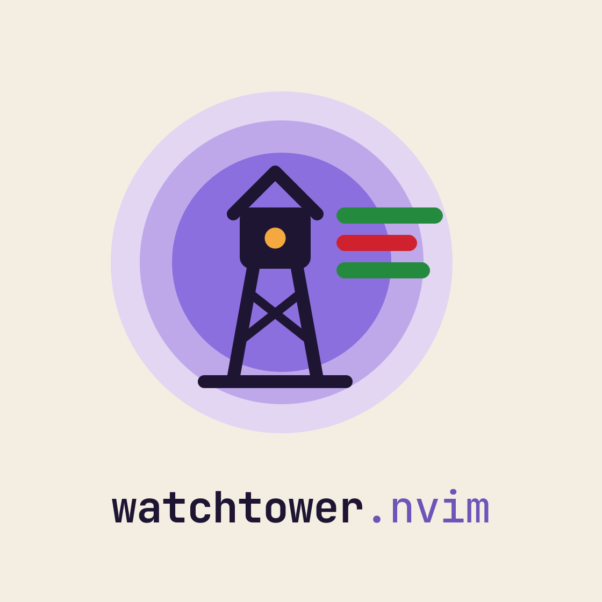

<p align="center"></p>

A git-diff-centric view for watching an AI agent edit your repo.

```
┌ tree ──────────────┬ diff ─────────────────────────────┐
│  repo  HEAD        │  M  lib/deep/kept.lua             │
│   lib/deep         │ @@ -17,7 +17,7 @@                 │
│    kept.lua      M │  line 17                          │
│    removed.lua   D │ -line 20                          │
│   new              │ +line 20 edited                   │
│    fresh.txt     ? │  line 21                          │
└────────────────────┴───────────────────────────────────┘
```

- The tree lists only files that differ from `HEAD` plus untracked files.
- The diff pane follows the tree cursor.
- `<CR>` in the diff opens the file at that line, in a split on the side away from the tree.
- The diff window stays pinned next to the tree (`pin_diff`); other windows go beyond it.
- Both panes refresh while files change on disk.
- With [claudecode.nvim](https://github.com/coder/claudecode.nvim), Claude sees the real file and line under your cursor or visual selection in the diff, not the diff buffer.

Requires Neovim >= 0.10 and git.

## Install (lazy.nvim)

```lua
{
  "joshcass/watchtower",
  lazy = false,
  opts = {
    open_on_startup = true, -- open right away when nvim starts (no file args) inside a git repo
    open_on_file = true, -- otherwise keep the dashboard and open with the first repo file you open
  },
  keys = {
    { "<leader>gw", "<cmd>Watchtower<cr>", desc = "Watchtower (diff view)" },
  },
}
```

`:Watchtower [toggle|open|close|refresh]`

## Configuration

Defaults:

```lua
{
  open_on_startup = false,
  open_on_file = false,
  pin_diff = true,       -- keep the diff window directly next to the tree
  base = "HEAD",
  tree = {
    position = "left",    -- "left" | "right": screen edge the tree sits on
    width = 35,
    icons = true,
  },
  open_file = {
    mode = "split",       -- "split" | "replace" (open in the diff window)
    direction = "away",   -- "away" (vertical split on the far side of the diff from the tree) | "above" | "below"
    reuse_window = true,  -- open in the most recently used away window instead of a new split each time
  },
  watch = { enabled = true, interval_ms = 1000 },
  claudecode = true,
  diff = { context = "dim" }, -- unchanged lines: "dim" | "syntax"
  highlights = {},       -- overrides, e.g. { WatchtowerDiffAdd = { bg = "#c7e1cb" } }
  keymaps = {
    tree = { select = "<CR>", open_file = "o", focus_diff = "l", collapse = "h", refresh = "R", close = "q" },
    diff = {
      open_file = "<CR>",
      next_hunk = "]c", prev_hunk = "[c",
      next_file = "]f", prev_file = "[f",
      focus_tree = "<BS>",
      close = "q",
    },
  },
}
```

Set any keymap to `false` to disable it.

### The view's own space

The tree and diff windows only ever show the tree and diff. Anything else opened in them is moved out to an "away" window (a normal window outside the view), at the same cursor position: a file picked from a picker while the tree is focused, `:e`, `:b`, and so on. The tree and diff buffers are put back.

Files from `<CR>`/`o` and those redirected files go to the away window you used most recently. If you split an away window and move into the new split, that split becomes the target. With `open_file.reuse_window = false` each one gets a new split on the far side of the diff instead. `open_file.mode = "replace"` is the exception: the diff window is then meant to show files, so it is left alone.

### Diff colors

The diff pane follows Claude Code's syntax-highlighted diff view:
- Added and removed lines get a soft full-line background.
- Added lines keep the code's treesitter syntax colors, from parsing the whole file on disk so partial hunks highlight like a normal buffer. Removed lines are drawn in one flat dark grey.
- Unchanged lines are faded toward the background (`diff.context = "dim"`); set `diff.context = "syntax"` to keep their code colors instead.
- When a removed line is replaced by an added line, the changed words get a stronger background (skipped when most of the line changed).
- A gutter shows each line's number: the old file's for removals, the new file's otherwise. On changed lines the number and the `+`/`-` marker use the sign color; on unchanged lines the gutter is dimmed.

The palette switches with `background`. Groups you can override with `highlights`:

| Group | Light | Dark |
| --- | --- | --- |
| `WatchtowerDiffAdd` | `#dcffdc` bg | `#022800` bg |
| `WatchtowerDiffDelete` | `#ffdcdc` bg | `#3d0100` bg |
| `WatchtowerDiffAddWord` | `#b2ffb2` bg | `#044700` bg |
| `WatchtowerDiffDeleteWord` | `#ffc7c7` bg | `#5c0200` bg |
| `WatchtowerDiffAddSign` | `#248a3d` fg (marker + line number) | `#50c850` fg |
| `WatchtowerDiffDeleteSign` | `#cf222e` fg (marker + line number) | `#dc5a5a` fg |
| `WatchtowerDiffDeleteText` | `#333333` fg | `#f8f8f2` fg |
| `WatchtowerDiffContext` | Normal fg blended 35% toward its bg | same |
| `WatchtowerDiffGutter` | Normal fg blended halfway to its bg (unchanged lines) | same |

Splitting a window off the tree or diff (`:split`, `<C-w>v`) shows the most recently used file in the new window instead of a second copy of the view. With no files open it returns to the most recent `[No Name]` buffer (even one you've typed in), and creates one only when none exists.

### Opening automatically

- `open_on_startup` opens the view in place of the dashboard when nvim starts in a git repo with no file arguments. It waits for the UI, so it works with GUIs like Neovide.
- `open_on_file` opens the view the first time a regular file from a git repo appears in a window after startup. Examples are a file picked from the dashboard, a project switch, or a restored session. The view is built around that window: tree | diff | file (mirrored with `tree.position = "right"`), and the file is selected in the tree if it has changes. It stays off after you close the view until the next `:cd`. Files passed on the command line (including `git commit`'s editor) and files under `.git/` never trigger it.

## How updates work

While the view's tab is current, `git diff <base> --name-status` and `git ls-files --others --exclude-standard` are polled every `watch.interval_ms`. The tree re-renders only when that list changes. The selected file's diff reloads when its mtime/size or the git index changes. A refresh also runs on `BufWritePost`, `FocusGained` and `TabEnter`.

## claudecode.nvim

claudecode.nvim reports the current buffer's name and line numbers to Claude. Watchtower wraps its selection functions so that while a watchtower buffer is focused:

| Where | What Claude receives |
| --- | --- |
| diff, cursor | real file path, line in the working tree file (deleted lines map to where they were) |
| diff, visual selection | real file path, the line range the selected diff lines map to, and the selected diff text (with `+`/`-`) as the selection text |
| tree | file under the cursor, positioned at its first change |
| `:ClaudeCodeSend` in diff / tree | at-mention for the mapped line range / the files in range |

The wrap is applied lazily the first time a watchtower buffer is used after claudecode.nvim loads, so it never forces claudecode.nvim to load.

## Tests

```sh
nvim --headless --noplugin -u tests/minimal_init.lua \
  -c "PlenaryBustedDirectory tests {minimal_init='tests/minimal_init.lua', sequential=true}"
```

Uses plenary.nvim from `stdpath("data")/lazy` or `$PLENARY_DIR`.
